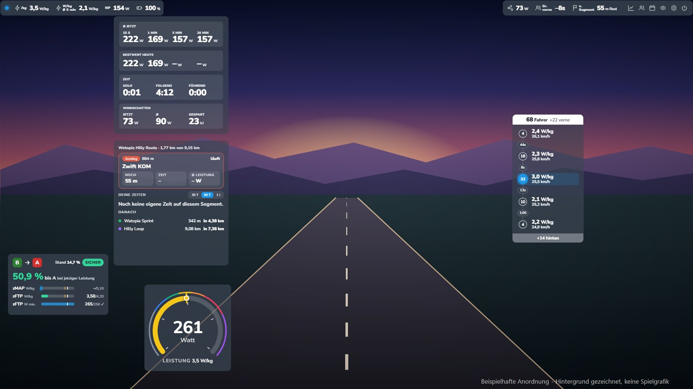
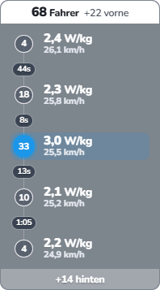
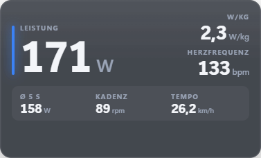
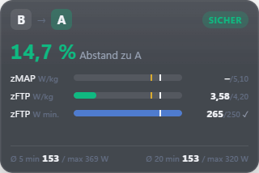
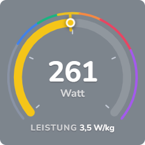
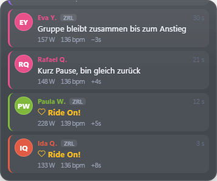
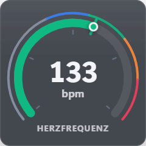
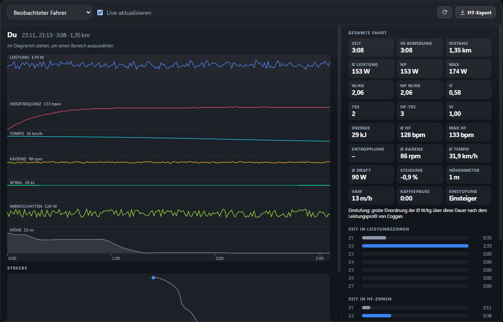
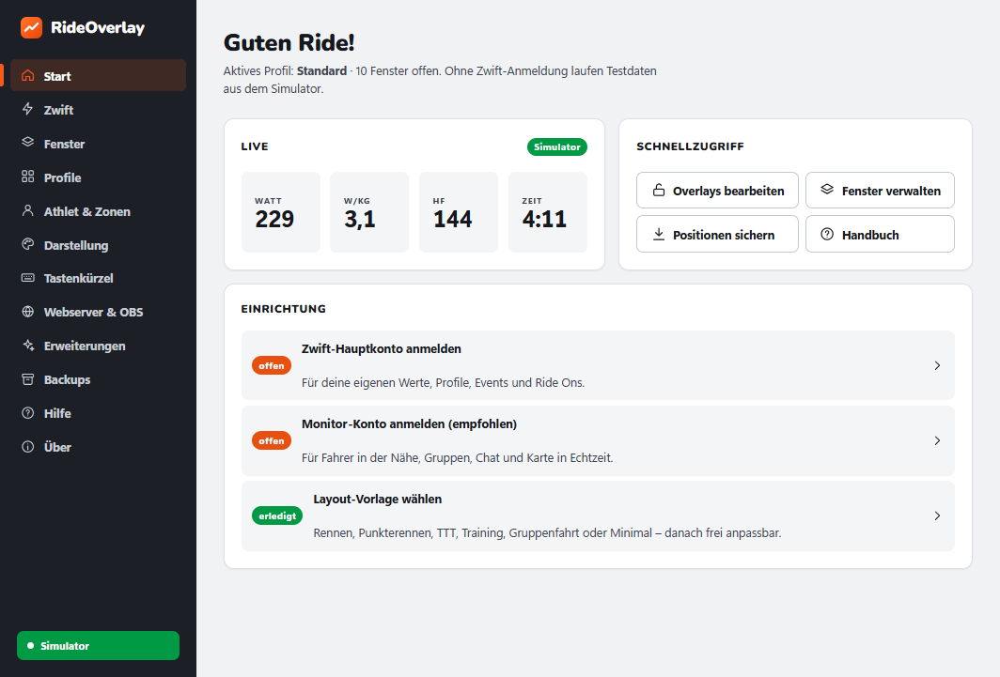
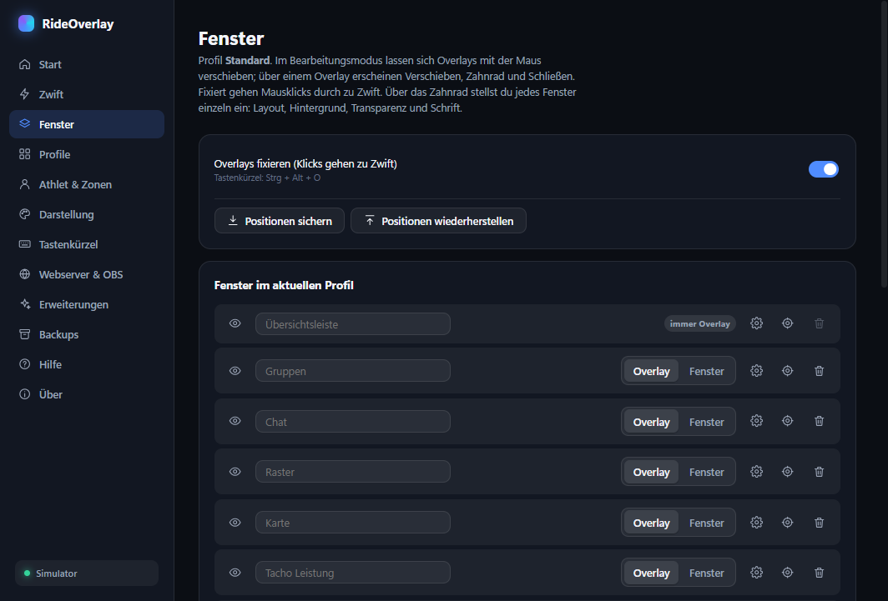

# RideOverlay

**Echtzeit-Overlays, Gruppen, Karte und Fahrtanalyse für Zwift – modern, schnell und datensparsam.**

[**⬇ RideOverlay herunterladen**](https://github.com/mazdaansbach/rideoverlay-releases/releases/latest)

 

Beispielhafte Anordnung der Vorlage „Rennen“ – der Hintergrund ist gezeichnet, keine Spielgrafik.

---

## Was ist RideOverlay?

RideOverlay legt sich während deiner Zwift-Fahrt als schlanke, durchsichtige Fenster über das Spiel und zeigt dir, was Zwift selbst nicht zeigt:
- wer vor und hinter dir fährt und mit welchem Abstand
- deine Werte im Detail: Normalized Power, W'bal, Zonen, Spitzenwerte
- wie nah du an der nächsthöheren Kategorie bist

Nach der Fahrt wertest du alles aus und exportierst die Fahrt als FIT-Datei.

Alles läuft **lokal auf deinem PC**. Es gibt kein Konto bei uns, keine Werbung und keine Telemetrie.

## Highlights

|                                           |                                                                                                                                                                                       |
| ----------------------------------------- | ------------------------------------------------------------------------------------------------------------------------------------------------------------------------------------- |
| **Gruppen & Abstände in Echtzeit**        | Gruppen vor und hinter dir als Blasen, mit Größe, Abstand in Sekunden, W/kg und Tempo. Fahrer in der Nähe als sortierbare Tabelle mit rund 50 wählbaren Spalten.                         |
| **Werte, wie du sie brauchst**            | Frei belegbares Raster, Tachos, Übersichtsleiste. Über 70 Felder, z. B. Leistung, W/kg, NP, TSS, W'bal, Zonen, Runden, Windschatten.                                                  |
| **Kategorie-Wächter**                     | Überwacht zMAP und zFTP gleichzeitig und warnt, **bevor** dich eine starke Fahrt in die nächste Pace-Gruppe hebt. Dazu die Höchstleistung für 5 und 20 Minuten.                     |
| **Karte & Höhenprofil**                   | Route, Fahrer, Segmente und verbleibende Strecke im Event.                                                                                                                            |
| **Analyse & FIT-Export**                  | Jede Fahrt mit Bereichsauswahl, Zonen, Spitzenwerten und Entkopplung auswerten, als FIT-Datei z. B. für Strava speichern.                                                             |
| **Events, Chat & Athleten**               | Event-Katalog mit Anmeldung, Teilnehmern und Ergebnissen, Chat der Fahrer in der Nähe, Profilkarten, Folgen und Ride On.                                                              |
| **Für Streamer**                          | Alle Overlays auch im Browser und als **OBS-Browserquelle**, geschützt per Zugriffsschlüssel.                                                                                         |
| **Durchdacht für das Spiel**              | Vorlagen verdecken weder deinen Fahrer noch Zwifts eigene Anzeigen. Im fixierten Modus gehen Klicks durch zum Spiel, und die Overlays blenden sich bei Bedarf aus, z. B. bei #nooverlays. |
| **Updates von selbst**                    | Neue Versionen kommen automatisch, sind digital signiert und werden **nie während einer Fahrt** installiert.                                                                         |

## Einblicke

<table>
  <tr>
    <td align="center" width="33%"> <b>Gruppen</b> – Abstände in Echtzeit</td>
    <td align="center" width="33%"> <b>Werteraster</b> – frei belegbar</td>
    <td align="center" width="33%"> <b>Kategorie-Wächter</b> – zMAP & zFTP im Blick</td>
  </tr>
  <tr>
    <td align="center"> <b>Tachos</b> – Leistung, HF, Kadenz, W'bal …</td>
    <td align="center"> <b>Chat</b> mit Werten der Fahrer</td>
    <td align="center"> <b>Herzfrequenz</b> mit Zonenfarben</td>
  </tr>
</table>

   
  <b>Analyse</b> – Verlauf, Zonen, Spitzenwerte, Bereichsauswahl und FIT-Export

<table>
  <tr>
    <td align="center" width="50%"> Startseite mit Live-Werten und Einrichtung</td>
    <td align="center" width="50%"> Fenster, Profile und Vorlagen verwalten</td>
  </tr>
</table>

## Installation

1. Unter [**Releases**](https://github.com/mazdaansbach/rideoverlay-releases/releases/latest) die Datei **`RideOverlay-Setup-x.y.z.exe`** herunterladen.
2. Datei starten. Weil RideOverlay kein kostenpflichtiges Signaturzertifikat hat, zeigt Windows beim ersten Mal *„Der Computer wurde durch Windows geschützt“*. Dann auf **„Weitere Informationen“ → „Trotzdem ausführen“** klicken.
3. Installieren, ohne Administratorrechte, nur für dein Windows-Konto.
4. In RideOverlay unter **Zwift** mit deinem Zwift-Konto anmelden, fertig. Ohne Anmeldung zeigt ein Simulator Beispieldaten, damit du alles in Ruhe einrichten kannst.

> **Tipp:** Für Fahrer in der Nähe, Gruppen, Chat und Karte in Echtzeit meldest du zusätzlich ein zweites, kostenloses Zwift-Konto als „Monitor-Konto“ an.

## Automatische Updates

RideOverlay prüft beim Start und alle 6 Stunden, ob es eine neue Version gibt:
- Updates werden im Hintergrund geladen und nur angenommen, wenn die **digitale Signatur** stimmt.
- Installiert wird erst nach deinem Klick, nie während einer Fahrt. Vorher entsteht automatisch ein Backup deiner Einstellungen.
- Nach dem Neustart siehst du, was neu ist.

## Datenschutz & Sicherheit

- **Lokal:** Einstellungen, Fahrten und Auswertungen bleiben auf deinem PC. Keine Telemetrie, keine Werbung.
- **Zugangsdaten:** nur mit der Windows-Datenschutz-Verschlüsselung gespeichert, nie im Klartext und nie in Protokollen oder Backups.
- **Abgeschottet:** Erweiterungen (Mods) laufen in einer Sandbox ohne Internetzugriff. Der Webserver für OBS ist standardmäßig aus und nur mit Schlüssel erreichbar.
- **Fair Play:** Veranstalter-Hashtags wie `#nooverlays` werden respektiert.

## Systemvoraussetzungen

|               |                                                                     |
| ------------- | ------------------------------------------------------------------- |
| System        | Windows 10 oder 11 (64 Bit)                                         |
| Zwift         | eigenes Zwift-Konto; für Echtzeitdaten ein zweites, kostenloses Konto |
| Bildschirm    | ab 1366 × 768, optimiert für Full HD                                |
| Speicherplatz | ca. 330 MB                                                          |

## Häufige Fragen

<b>Steuert RideOverlay das Spiel oder verändert es etwas an Zwift?</b>

Nein. RideOverlay beobachtet nur und zeigt Daten an. Es sendet nichts in deinem Namen, außer du klickst selbst z. B. auf „Ride On“ oder „Folgen“.

<b>Warum warnt Windows bei der Installation?</b>

Um diese Warnung zu vermeiden, bräuchte es ein kostenpflichtiges Code-Signatur-Zertifikat. Die Echtheit der Updates sichert RideOverlay stattdessen mit einer eigenen digitalen Signatur.

<b>Ich sehe keine Fahrer in der Nähe.</b>

Dafür braucht RideOverlay das zusätzliche Monitor-Konto, siehe Installation, Schritt 4. Mit nur einem Konto gibt es deine eigenen Werte mit etwa 2 Sekunden Verzögerung.

<b>Kann ich RideOverlay für meinen Stream nutzen?</b>

Ja. Unter „Webserver & OBS“ einschalten und den Link eines Fensters als Browserquelle in OBS einfügen. Die Hintergründe sind dort durchsichtig.

<b>Wo finde ich die Anleitung?</b>

In der App unter **Hilfe**, dort auch als PDF speicherbar.

## Hinweise

RideOverlay ist ein privates, inoffizielles Projekt und steht in keiner Verbindung zu Zwift Inc. „Zwift“ ist eine Marke der Zwift Inc. Die App nutzt nicht-öffentliche Schnittstellen. Die Nutzung erfolgt auf eigenes Risiko und im Rahmen der Zwift-Nutzungsbedingungen.

© 2026 RideOverlay · kostenlos für den privaten Gebrauch

